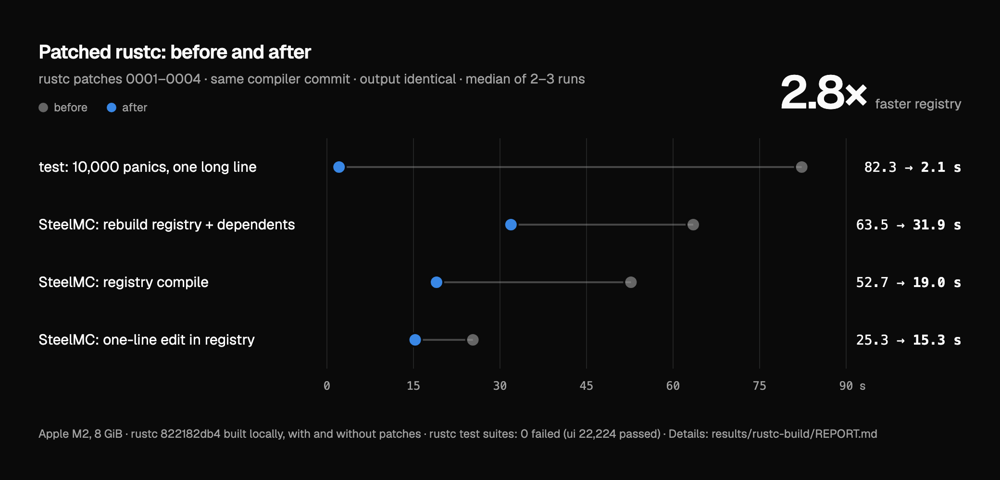
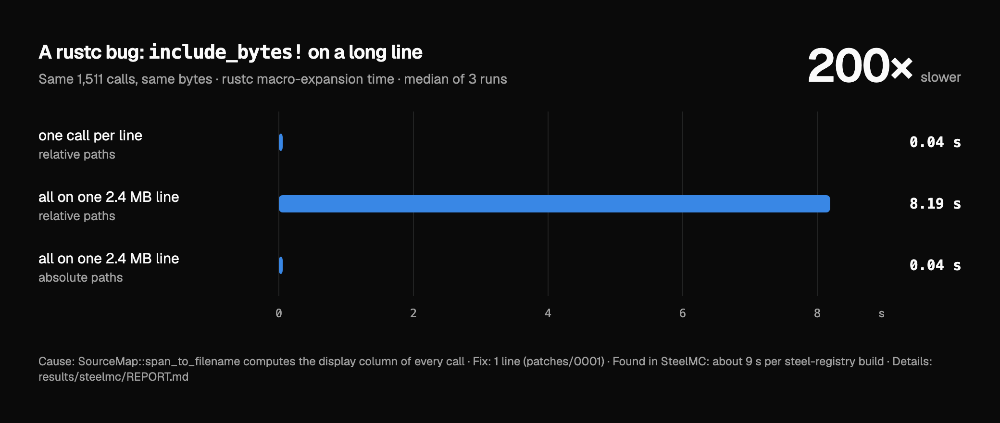

# rustc long-line speedups

Four small patches to the Rust compiler (`rustc_span`) that remove work which grows with the
length of a source line. Code that puts a lot on one line — for example code that a build script
writes with `TokenStream::to_string()` — gets much faster to compile. The compiled output is the same.

> **LLM disclosure.** These patches, the tests, the measurements and this README were made with an
> LLM (Anthropic's Claude) and checked on my machine. They are **not** submitted to rust-lang/rust:
> the [Rust LLM policy](https://forge.rust-lang.org/policies/llm-usage.html) asks that LLM-created code
> is pre-arranged with a reviewer. Anyone is welcome to use them, rewrite them, or submit their own fix.



## The problem

When rustc needs a source position as "file, line, column", it computes the column by walking the
characters of the line from its start. Three things made that expensive:

1. `SourceMap::span_to_filename` computed line and column only to return the file name. Every
   relative `include_bytes!`, `include_str!` and `include!` calls it (through `Session::resolve_path`).
2. The display column summed `char_width` over every char from the line start.
3. The plain column summed over every multi-byte char from the **file** start, twice per lookup,
   and the line text was found by searching for the end of the line on every call.

Every panic location (`unwrap`, indexing, overflow checks in debug builds) needs file, line and
column. So on a line that is megabytes long, the cost is *(number of lookups) × (line length)*.



Found while measuring [SteelMC](https://github.com/Steel-Foundation/SteelMC): its build script writes
17 MB of generated Rust as one line per file, with 1,511 `include_bytes!` calls.

## The patches

All apply to rust-lang/rust `822182db4` (nightly-2026-10-14) and, with line offsets only, to
`54d0b7e` (master, 2026-11-08). `patches/combined-0001-0004.patch` has all four.

| Patch | Change | Lines |
|---|---|---|
| [0001](patches/0001-span-to-filename-skip-column-lookup.patch) | `span_to_filename`: look up only the file (`lookup_source_file`) | +2 −1 |
| [0002](patches/0002-span-fast-ascii-display-column.patch) | display column of an ASCII prefix = chars + 3 × tabs (byte scan), else the old per-char sum; unit test | +46 −1 |
| [0003](patches/0003-span-binary-search-columns-and-file-only-lookup.patch) | column: binary search to the multi-byte chars of the current line; line prefix sliced as `src[line start..pos]`; one debug-info lookup that needed only the file now uses `lookup_source_file`; reference test | +67 −7 |
| [0004](patches/0004-span-long-line-width-index-in-sourcemap.patch) | for line prefixes over 4 KiB: a cache in the `SourceMap` (not in each `SourceFile`) with, per file that needs it and only for its long lines, the chars whose width is not 1 and running totals — two binary searches | +125 −3 |

Pictures of each diff: [0001](images/patch-0001.png), [0002](images/patch-0002.png),
[0003](images/patch-0003.png), [0004](images/patch-0004.png).

## Results

Apple M2, 8 GiB. Both compilers built from the same commit (`822182db4`) with the same settings,
with and without the patches. Test crates: 3 runs each.

| Test (from `repro/`) | Before | After | Output |
|---|---|---|---|
| 1,511 relative `include_bytes!` on one 2.4 MB line | 8.7 s | 1.1 s | identical |
| 10,000 panic locations on one long line | 80.7 s | 2.1 s | identical |
| the same code with normal short lines | 1.1 s / 2.1 s | 1.1 s / 2.1 s | identical |

| Real project | Before | After |
|---|---|---|
| SteelMC `steel-registry` compile | 52.7 s | 18–20 s |
| SteelMC one-line edit in `steel-registry` | 25.3 s | about 15 s |
| GPUI, Zed (normal short lines) | no measurable change | no measurable change |

SteelMC "after" numbers were measured with an earlier version of 0004 (index stored in each
`SourceFile`); the current version gave the same test-crate times and SteelMC times within noise.
GPUI and Zed details: [gpui.png](images/gpui.png), [zed.png](images/zed.png).

## How correctness was checked

- New test `lookup_char_pos_matches_reference` compares line, column and display column at every
  char boundary of seven files (tabs, wide, zero-width and multi-byte chars, CRLF, byte-order mark,
  lines over 4 KiB) with the original algorithm written out. It passes on patched **and** unpatched
  rustc. (It caught one real difference in a draft, at the end of a file after a trailing newline.)
- New unit test for the ASCII fast path.
- `./x test --stage 1` for `compiler`, `tests/ui` (22,224 passed), `ui-fulldeps`, `incremental`,
  `codegen-llvm`, `codegen-units`, `assembly-llvm`, `mir-opt`, `pretty`, `coverage` (map),
  `crashes`, `run-make`, `rustdoc-ui`: 0 failed. Not run on my machine: coverage-run and debuginfo
  (no profiler runtime or debugger), library and tool suites.
- Outputs: test-crate object files byte-identical; SteelMC and GPUI binaries differ only where two
  builds by the same compiler also differ (timestamp string, code signature). Zed's build is not
  reproducible even with one compiler, so for Zed this only shows no extra difference.
- `./x fmt --check` clean.

Note: a local `git commit` in the rustc tree changes the compiler's version hash, which changes
symbol names in every output. Compare compilers built from the same commit, with the patches
as uncommitted changes.

## Use it

```bash
git clone https://github.com/rust-lang/rust && cd rust
git checkout 822182db4c4a1827256881d8c7aa685f0bcf2b11   # or current master
git apply /path/to/patches/combined-0001-0004.patch
./x build --stage 1 library
rustup toolchain link stage1-long-lines build/host/stage1
```

Reproduce the measurements with two linked toolchains (`before`, `after`):

```bash
repro/compare.sh before after
```

## Limits

- Only code with very long lines, many relative `include_*!` calls, or many non-ASCII chars gets faster.
- 0004 adds a small cache to the `SourceMap`; it stays empty unless a line over 4 KiB is looked up.
- One machine (macOS, Apple M2); small run counts.

## License

The patches change rust-lang/rust and are offered under the same terms: MIT or Apache-2.0
([LICENSE-MIT](LICENSE-MIT), [LICENSE-APACHE](LICENSE-APACHE)).
